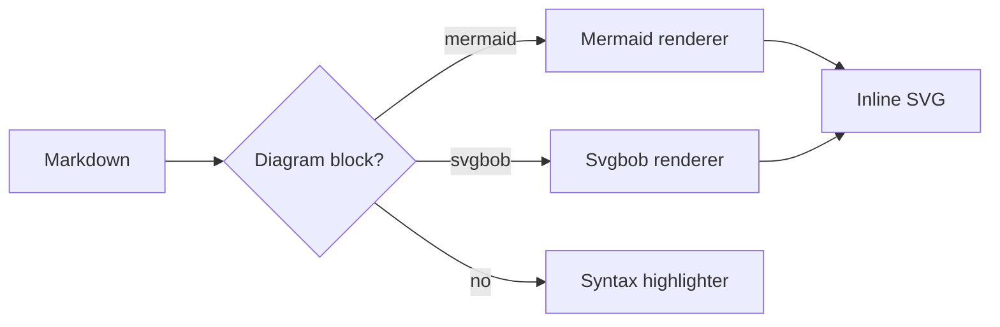
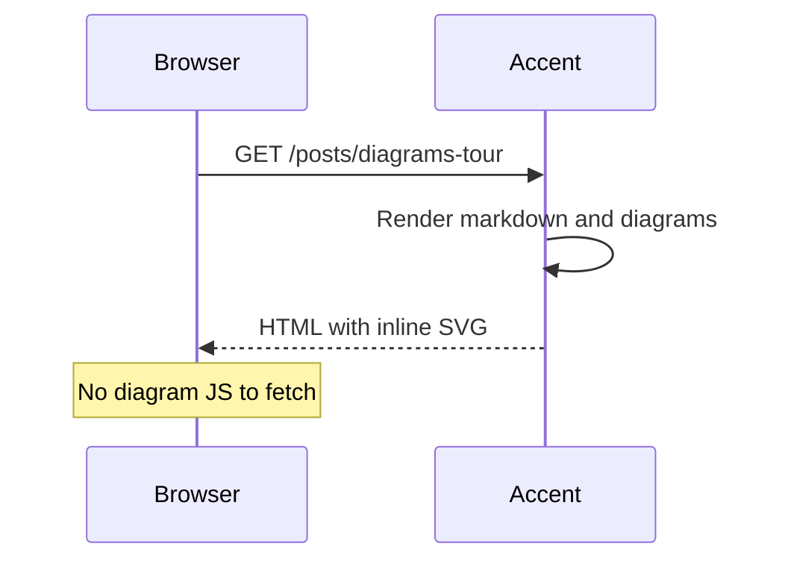

Accent renders text-based diagrams on the server. You write the source in
a fenced code block, and the page gets inline SVG. Search engines and
reader modes see the picture, and the browser loads no diagram library.
This demo runs with `diagrams.render_mode: server`, so the development
server shows the same SVG as a production build.

## Mermaid flowchart

Tag a fenced block with `mermaid`:



## Mermaid sequence diagram

The first line of the block selects the dialect. The renderer covers all
23 Mermaid dialects, from `sequenceDiagram` to `gantt` and `pie`:



## With a caption

The `` tag adds a caption and alt text. It renders through
the same pipeline and the same cache as a fenced block:


pie title Page weight
  "HTML" : 62
  "CSS" : 26
  "JS" : 12


## Svgbob

Svgbob turns ASCII art into clean SVG. Tag a fenced block with `svgbob`
or the shorter `bob` alias:

```svgbob
 +--------+      +--------+      +--------+
 |  .md   |----->| Accent |----->|  SVG   |
 +--------+      +--------+      +--------+
                     |
                     v
                 .-------.
                (  cache  )
                 '-------'
```

The renderer is pure Rust, so it works everywhere Accent does.

## Caching

Each rendered SVG is cached by a hash of its source and its render
options. A repeat build reuses the cache, and an edit to one diagram
re-renders only that diagram.
